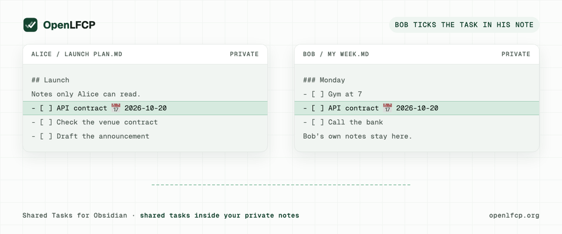
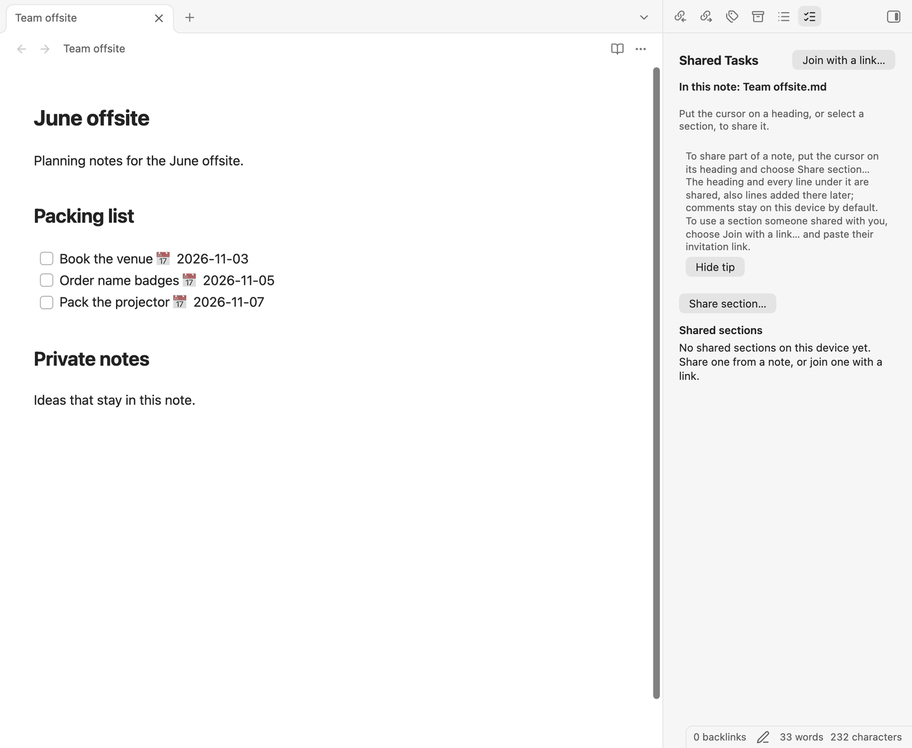
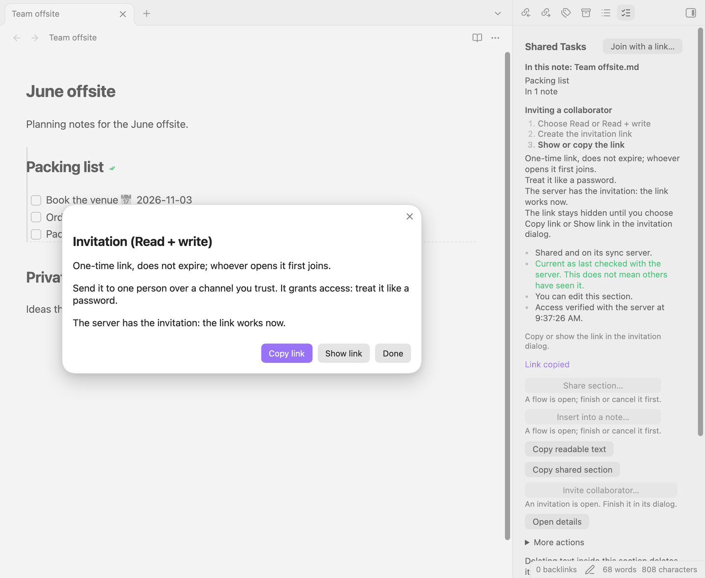
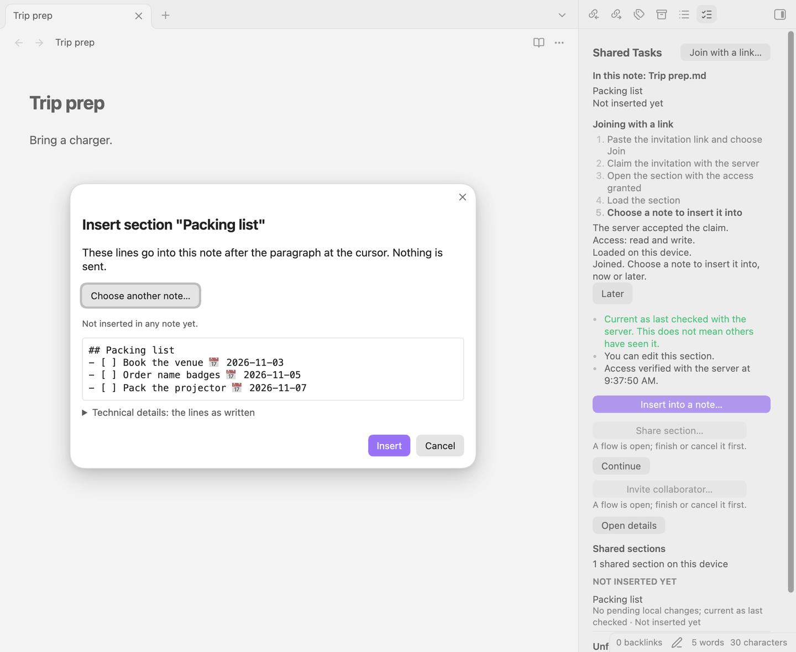
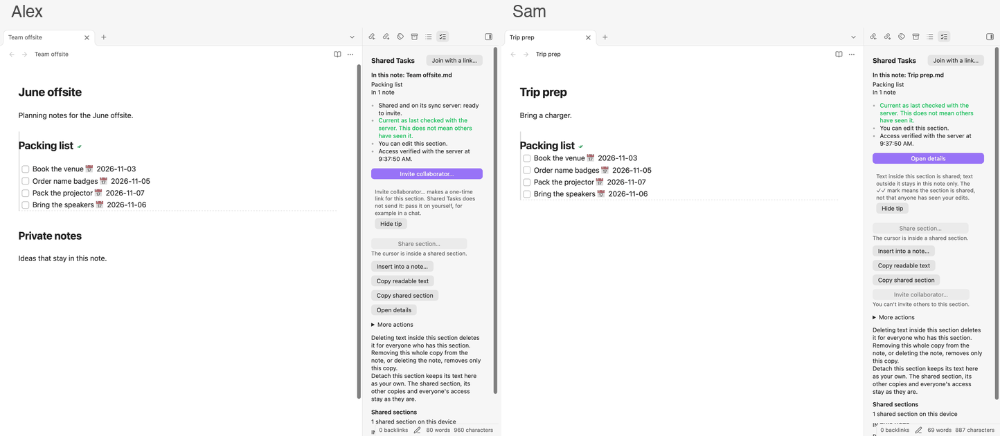
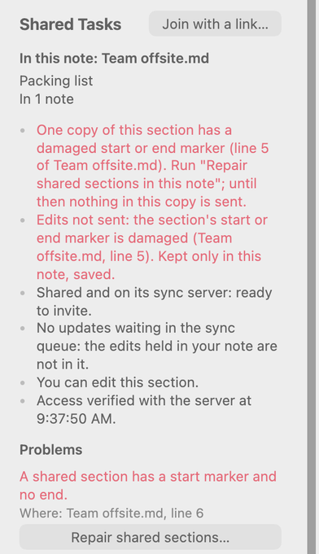
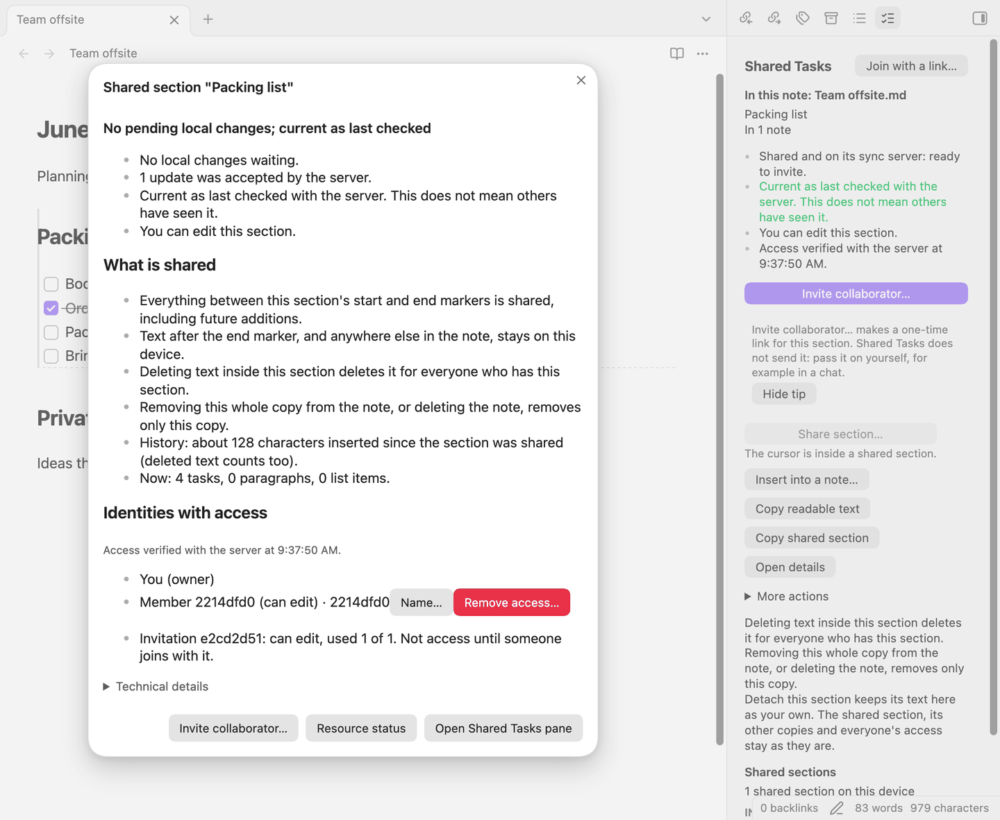

<picture><source media="(prefers-color-scheme: dark)" srcset="https://raw.githubusercontent.com/openlfcp/.github/main/docs/assets/brand/openlfcp-mark-dark.svg"></picture>

# Shared Tasks for Obsidian

Shared tasks inside your private notes. By OpenLFCP (Open Local-First
Collaboration Protocol).

Website: [openlfcp.org](https://openlfcp.org)



**Beta.** Plugin ID `shared-tasks`; for the current version, see the
[latest release](https://github.com/openlfcp/obsidian/releases/latest).

## Quick start

Shared Tasks 0.5 leads you through sharing, inviting and joining from a
visible pane and from a card on the section, so you don't have to learn the
commands. Everything about sections (share, invite, join, insert, repair,
conflicts, copy, detach) is in the pane and the card; single tasks are still
shared with commands. The pane and its dialogs work from the keyboard. (Stable 0.5.0 reaches Community plugins at its release; until then
0.5.0 pre-releases are installed with BRAT, see [Install](#install).)

1. **Install.** In Obsidian 1.13.4 or later, open Settings → Community
   plugins → Browse, search for "Shared Tasks", install it and enable it
   (0.5.0 once released; until then the beta via BRAT, see below).
2. **Open the pane.** Click the Shared Tasks icon in the ribbon. The pane
   follows the note you are in and offers the next step for the cursor. The
   first time, short tips explain what each action does; "Hide tip" hides
   one and "Show tips again" brings them back.

   
3. **Share.** Put the cursor on a heading. The pane offers "Share
   section…" and shows what will be shared and what stays private before
   you confirm. Then it offers "Invite collaborator…": choose Read or
   Read + write and copy the one-time link. **Send it privately**; Shared
   Tasks does not send it.

   
4. **Join.** Your collaborator opens their pane, chooses "Join with a
   link…" and pastes the link. The pane shows each step, then asks which
   note to put the section in and previews the result.

   
5. **Work together.** Edits sync both ways, offline too. When something
   needs you, the pane's problem list opens the matching fix.

The same steps work from the command palette ("Shared Tasks: Share
section…", "Invite to this section…", "Legacy: Join task collaboration",
"Insert shared section…"); the commands have no default hotkeys (assign
them in Obsidian's Hotkeys settings). "Invite to this section…" invites to
the shared section at the cursor, as the pane does. Step by step, with everyday use and
troubleshooting:
**[the user guide](https://github.com/openlfcp/obsidian/blob/0.4.1/docs/guides/user-guide.md)**
(describes the command flow of 0.4; the pane is described above).

## What it does

- **Collaboration without learning the commands.** A visible pane and a
  card on each shared section lead you from Share to Invite, and from Join
  to choosing where the section goes.
- **Problems with a way out.** The pane lists what needs attention (a
  conflict, a line that went missing) and opens the matching fix.
- **Nothing half-done is lost.** A share cut short by closing Obsidian resumes
  by itself after the restart; an unfinished insert or join is listed in the pane,
  where you continue it or check the result.
- **Share one task, not your vault.** Put the cursor on a task and share
  it; the rest of the note stays on your device.
- **Invite with a one-time link.** The other person joins with it, from
  their own vault, with "Read" or "Read + write" access.
- **Works offline.** Edit while offline; changes sync when you are back,
  and edits on both sides are kept.
- **Markdown stays Markdown.** A shared task is an ordinary task line in
  the Obsidian Tasks syntax (`📅 2026-10-20`, `✅`), with a small
  `<!-- lfcp-ref: … -->` comment that links it.
- **Shared sections.** Share a heading with everything under it:
  tasks, subtasks, paragraphs and lists, in order. Whatever is added to the
  section later is shared too. See [Shared sections](#shared-sections).

## Install

Shared Tasks needs Obsidian 1.13.4 or later.

**From Community plugins (recommended):**
1. Settings → Community plugins. If "Restricted mode" is on, turn it off.
2. Click "Browse" and search for **Shared Tasks**
   ([directory page](https://obsidian.md/plugins?id=shared-tasks)).
3. Install it, then enable it.

**Pre-release builds, with BRAT:**
1. Install and enable [BRAT](https://github.com/TfTHacker/obsidian42-brat)
   from Settings → Community plugins.
2. Run "BRAT: Add a beta plugin for testing" from the command palette.
3. Enter `openlfcp/obsidian`. In the version field choose **Latest
   version**: a specific version stays installed, and BRAT will not update
   it.
4. Enable "Shared Tasks" in Settings → Community plugins, and check the
   version it lists is the one you meant to try.

Stuck on an older beta? In BRAT's settings, find `openlfcp/obsidian` in the
beta plugin list: if it shows a version, it is pinned there. Edit it and
choose **Latest version** (or remove it and add it again with Latest
version), then run "BRAT: Check for updates to all beta plugins". BRAT's
setting "Select latest plugin version by default" saves choosing.

**By hand:** from the
[latest release](https://github.com/openlfcp/obsidian/releases/latest),
download `main.js`, `manifest.json` and `styles.css` into a new folder
`<vault>/.obsidian/plugins/shared-tasks/`, then enable "Shared Tasks" in
Settings → Community plugins.

Upgrading from 0.1.0, which was called "OpenLFCP": see
[docs/releases/0.2.0.md](docs/releases/0.2.0.md).

## Your first shared section

New here? The [step-by-step guide](https://github.com/openlfcp/obsidian/blob/0.4.1/docs/guides/user-guide.md)
(describes the command flow of 0.4; the pane is described above) covers setup
and everyday use, including what to do when something goes wrong.

Two people, each with their own vault and Shared Tasks installed. You can
do all of it from the pane; the matching commands are in brackets.

1. **Share.** Put the cursor on a heading and click "Share section…" in the
   pane ("Shared Tasks: Share section…"). Check the preview, keep the
   suggested server (`wss://sync.openlfcp.org/v1/ws`, see "Which server")
   and confirm. A `lfcp-` comment appears after the heading and beside each
   line; nothing outside the section changes.
2. **Invite.** Click "Invite collaborator…" ("Shared Tasks: Invite to this
   section…", with the cursor in the section), choose Read or Read + write, and copy the link. **The
   link is a secret**: it is one-time and does not expire, and whoever opens
   it first joins. Send it privately.
3. **Join and insert.** In their vault the other person clicks "Join with a
   link…" ("Shared Tasks: Legacy: Join task collaboration"), pastes the link, then picks
   the note and the place to insert the section ("Shared Tasks: Insert
   shared section…") and checks the preview.
4. **Work together.** When either of you ticks a task or edits a line, the
   other note shows it within seconds.

   
5. **If something needs you,** the pane's problem list says what and opens
   the conflict dialog or "Repair shared sections in this note".

   

The section card, shown beside a shared heading, offers the same next step:



### One task at a time

You can still share single tasks. These commands are named "Legacy: …" and
show in the palette only in a vault that already holds a task collaboration
(the join command is always there); a new vault does not list them. Run
"Shared Tasks: Legacy: Create task collaboration",
give it a name only you see and keep the suggested server. Put the cursor on
a task, for example `- [ ] Prepare API contract 📅 2026-10-20`, run "Shared
Tasks: Legacy: Share task under cursor" and pick the collaboration; a `lfcp-ref`
comment appears under the task. Invite with "Shared Tasks: Legacy: Invite to
task collaboration". The other person runs "Legacy: Join task collaboration", puts the cursor
on an empty line and runs "Shared Tasks: Legacy: Insert shared object". When either
of you ticks the task (`- [x]`), the other note shows it done, with its `✅`
date.

The full command walkthrough, with what to expect at each step:
[docs/demos/two-vault-demo.md](docs/demos/two-vault-demo.md).

### Many tasks at once

- **"Shared Tasks: Legacy: Share selected tasks"** shares every task line you
  selected. With nothing selected, it shares the tasks under the heading
  at the cursor, down to the next heading of the same or a higher level.
  You pick the collaboration once; each task becomes a shared task of its
  own, nested ones included. Tasks already shared are skipped, and tasks
  with a broken `lfcp-ref` are left alone. One notice says how many were
  shared.
- **"Shared Tasks: Legacy: Insert all tasks from task collaboration"** places, at the
  cursor, every task of a collaboration that this note does not show yet,
  in the order they were created.

Everyone invited to a collaboration sees every task in it, including tasks
you add later. Each command handles at most 200 tasks; above that it does
nothing and says so. A list shared this way is not itself shared: its
order and heading, and tasks added to it later, stay local in each note.
To share a section as a whole, use a shared section (below).

## Shared sections

A shared section is a heading and everything under it, down to the next
heading of the same or a higher level. Everyone in it keeps the section in
their own note, edits it, and sees the others' changes. Its order, nesting
and paragraphs are shared, and so is whatever is added inside it later.
Each section has its own collaboration and its own key.

Shared sections are on since Shared Tasks 0.4.0: there is nothing to turn
on. Put the cursor on a heading, or under it, and run "Shared Tasks: Share
section…"; a preview shows exactly what will be shared and what stays
private. The 0.3 setting `"sectionsPreview"` no longer does anything. To
turn sections off, quit Obsidian, add `"sectionsDisabled": true` to
`.obsidian/plugins/shared-tasks/data.json` and start it again; shared
tasks work either way. The
[shared sections guide](https://github.com/openlfcp/obsidian/blob/0.4.1/docs/guides/shared-sections.md) covers sharing,
inviting, joining and inserting, what the marks mean, conflicts, removing
access, detaching and repair.

In the note, a shared section carries one comment after its heading, one
at its end, and one beside each task, paragraph and list item. Live
Preview hides them. Source mode shows them, and so does "Show or hide
sharing metadata". "Copy readable text (without sharing metadata)" copies
the text without them.

## What's shared, what stays private, what the server sees

| | |
| --- | --- |
| **Shared** with your collaborators | The tasks you share: title, status, dates, priority, tags. For a shared section: its heading's title and everything under it (tasks, paragraphs, list items, their order and nesting), including what is added later. Comments inside a section (`%% … %%`, `<!-- … -->`) stay on your device unless you choose to share them in the settings. End-to-end encrypted: only members of the collaboration can read them. |
| **Stays private** | Everything else in your vault, including the text around a shared task or outside a shared section, and your keys, which never leave your device. Each vault has its own identity, a key pair, not an account. |
| **The server sees** | Encrypted data it cannot read, plus the metadata it needs: public keys, collaboration IDs, who may read or write, sizes and counts of changes, and your IP address when you connect. Details: the server's [privacy note](https://github.com/openlfcp/.github/blob/main/docs/operations/sync-server-privacy.md). |

## Which server

"Legacy: Create task collaboration" suggests the free public beta server of the
OpenLFCP project, `wss://sync.openlfcp.org/v1/ws`. Read its
[privacy note](https://github.com/openlfcp/.github/blob/main/docs/operations/sync-server-privacy.md)
and [terms](https://github.com/openlfcp/.github/blob/main/docs/operations/sync-server-terms.md)
first. Or run your own:
[openlfcp/server](https://github.com/openlfcp/server) has a container
setup in [`deploy/`](https://github.com/openlfcp/server/tree/main/deploy).
Change the suggestion in Settings → Shared Tasks → "Default server".

A collaboration stays on the server it was created on, and people who join
use the server named in the invitation. More:
[docs/guides/choosing-a-server.md](docs/guides/choosing-a-server.md).

If the server lost data (it was restored from an older backup), Shared
Tasks repairs it from your device: it hosts a lost collaboration there
again, sends back the changes the server no longer has, and shows one short
notice. Your collaborators' devices do the same, so whoever connects first
brings the server up to date.

If the server no longer has a collaboration and refuses to host it again,
or no longer lets you read it, Shared Tasks shows one notice and "Resource
status" says why, for example "Not hosted by wss://…". Syncing that
collaboration stops (Shared Tasks does not keep retrying), and your tasks
stay on this device. Restarting Obsidian asks the server again.

## Offline and conflicts

Edit shared tasks offline as usual. Changes wait on your device and are
sent when the server is reachable again. Edits to
different fields merge: if you rename a task while your collaborator moves
its date, both changes arrive.

If you both change the same field while apart, nothing is lost and no
conflict text is written into your note. The note shows one of the two
values, the status bar says "Shared Tasks: 1 shared task has a conflict",
and the task line gets a marker naming the field. Example: you mark the task in
progress (`[/]`) and your collaborator cancels it (`[-]`). Put the cursor on
the task, run "Shared Tasks: Resolve shared task conflict", pick `status`
and the value to keep; both notes then show it.

## Compatibility

- Obsidian 1.13.4 or later.
- Before 0.4.0, automated runs in real Obsidian 1.13.4 and 1.14.4 (on
  Linux) checked a fresh install, updates from 0.3.4 and from a 0.4 beta,
  turning the plugin off and on, light and dark theme in Source, Live
  Preview and Reading view, and running with the Tasks plugin on and off
  ([support matrix](docs/devel/testing/support-matrix-0.2.md)).
- The automated platform smoke (build, tests and the two-vault E2E against
  the real server) runs on macOS, Windows and Linux. The plugin has not
  been tried by hand on Windows, nor with an input method (IME) for
  languages such as Chinese, Japanese or Korean.
- Mobile (iOS, Android): the plugin is not desktop-only, and on mobile it
  opens shared sections read-only (see "Limitations"). Automated tests
  cover that read-only path; it has not been tested on a phone or tablet.
- Tasks use the Obsidian Tasks plugin's emoji syntax for dates, priority
  and completion. Some Tasks tokens (🔁 🛫 ➕ ❌ 🔼) stay local to your
  note; the share preview shows them.

## Limitations

Beta software. **Not for data you need to protect yet.**

- Data on the public server can be lost, including recent changes after
  the server is restored from a backup; keep your vault, whose notes hold
  the text of everything you share, and keep this device's sync data (see
  [Where your data is kept](#where-your-data-is-kept)).
- A collaboration cannot move to another server.
- Invitations offer "Read" and "Read + write" only. For tasks shared one
  by one, there is no member management in the plugin yet. For a shared
  section, "Remove access…" in its details removes someone's future
  access; copies they already received cannot be erased.
- An invitation is a link (no QR code); a copied link stays on the
  clipboard.
- Shared text in your notes is ordinary Markdown, readable by anyone who
  can read the vault; only the plugin's copy of the shared state is
  encrypted on the device (see
  [Where your data is kept](#where-your-data-is-kept)). Obsidian's secret
  storage, which holds the keys, is shared by every plugin on the device.
- **Mobile.** Shared sections are read-only on mobile: they arrive and are
  shown, and edits made there stay on the device. The section commands
  are still listed, but sharing a section, inviting to one and removing
  access are refused there as read-only. Shared tasks are not restricted.
  None of this has been tested on a real device yet.
- **Section size.** About 200 tasks with their notes is the qualified size
  of a section. A much larger one works, but each edit blocks the editor
  for seconds. A section after many thousands of edits gets slower.
- **No headings inside a section:** sharing offers to split it into
  sections.
- **No going back to 0.3.x** on a device once 0.4 has upgraded its sync
  data; downgrade only to 0.4.x or later
  ([details](docs/releases/0.4-compatibility.md)).

All known limitations: the release notes of
[Shared Tasks](docs/releases/) (for 0.4, [0.4.0](docs/releases/0.4.0.md)
and [0.4.1](docs/releases/0.4.1.md)),
[OpenLFCP MVP 0.2](https://github.com/openlfcp/.github/blob/main/docs/release/mvp-0.2-release-notes.md),
[OpenLFCP MVP 0.1](https://github.com/openlfcp/.github/blob/main/docs/release/mvp-0.1-release-notes.md)
and
[server 0.2.0](https://github.com/openlfcp/.github/blob/main/docs/release/server-0.2.0-release-notes.md).

## Where your data is kept

- **Your notes are plain Markdown.** Shared tasks and sections are ordinary
  text in your notes, with small `lfcp-` comments that link them. They are
  stored like the rest of your vault, readable and not encrypted by Shared
  Tasks; whoever can read your vault can read them.
- **The shared state on the device is encrypted.** Since 0.4.0, the
  decrypted shared state and the plugin's own records are sealed at rest
  under keys kept on that device. The changes themselves and the outgoing
  queue are stored as they travel, end-to-end encrypted; IDs and counters
  stay readable. Settings → Shared Tasks → "Local encryption" → "Rotate
  key" replaces the keys. This is a separate layer from the end-to-end
  encryption of what goes to the server.
- **Keys and sync state are outside the vault.** Your identity, the
  collaborations' keys and the sync data live in Obsidian's own storage on
  this device (IndexedDB and secret storage), not in the vault folder.
  A copy or backup of the vault holds your notes but not your place in
  the collaborations: opened on another device, through Obsidian Sync,
  iCloud or Git, Shared Tasks starts there as a new identity that is not a
  member of them. The plugin's `data.json` holds only settings.

## Network use

The plugin connects only to the sync servers of your collaborations, over
WebSocket (`wss://`). It sends only end-to-end encrypted data and the
protocol metadata a server needs (public keys, Resource IDs, sizes); the
server also sees your IP address. There is no account, no telemetry and no
payment.

## What the plugin accesses

- **Your notes, locally.** At startup the plugin looks through every
  Markdown note of the vault for its markers (`lfcp-` comments: task refs,
  and the boundaries and node markers of shared sections), using Obsidian's
  content cache. Notes with a marker are synchronized; notes without one are
  not touched. Afterwards it reacts to note changes as you make them. None
  of your notes leaves the vault: only the shared tasks you chose go out,
  end-to-end encrypted.
- **The clipboard,** written only when you ask: "Copy link" in the
  invitation dialog, "Copy readable text (without sharing metadata)", "Copy
  shared section", and copying a diagnostics report. When you copy from a
  shared section in Reading view, the plugin leaves its status marks out of
  what you copied. The plugin never reads the clipboard.
- **A file in your vault,** only when you save a diagnostics report there
  ("Export diagnostics…"). The report is shown in full before you copy or
  save it, holds no note text or secrets, and is never sent.
- **The network,** only `wss://` connections to the servers of your
  collaborations (see "Network use").
- **Local storage on this device:** IndexedDB for the sync state (its
  decrypted part sealed at rest), and Obsidian's secret storage for the
  keys; neither is inside the vault.
- **Bundled WebAssembly:** see below. Nothing is downloaded at run time.

### Bundled WebAssembly

`main.js` contains one WebAssembly module: `automerge_wasm_bg.wasm` from
[Automerge](https://github.com/automerge/automerge) 3.5.0 (the npm package
`@automerge/automerge`, the CRDT engine the SDK uses), unchanged. The build
takes the bytes from the package's own base64 module, compresses them
(deflate) and stores them in `main.js` as base64; when the plugin starts
they are decompressed and compiled. `scripts/build-plugins.mjs` does this,
and `test/bundle.test.ts` checks it.

You can check that the release's `main.js` holds nothing else: a release
is built by CI from the tagged commit, with the SDK and Automerge from npm
at the versions in `pnpm-lock.yaml` (`pnpm install --frozen-lockfile`;
`scripts/check-release-deps.mjs` refuses a commit that links the SDK from
a local checkout instead), and carries a build provenance attestation
(`gh attestation verify main.js --repo openlfcp/obsidian`). Building the
same commit with `pnpm install --frozen-lockfile && pnpm build` gives the
same `main.js`: the native workflow's `release_build` run prints its
SHA-256 (`.github/workflows/native.yml`), each release candidate's report
in `docs/devel/reports/` records that a local build's checksum equals it,
and the release notes list the SHA-256 of each release file to compare
with.

## Support

- Bugs and questions: [GitHub issues](https://github.com/openlfcp/obsidian/issues).
- Security vulnerabilities: **security@openlfcp.org**, or a
  [private security advisory](https://github.com/openlfcp/obsidian/security/advisories/new);
  not a public issue.
- Everything else: **hello@openlfcp.org**.

## For developers

This repository is the Obsidian editor adapter and product UI for OpenLFCP.
It consumes `sdk-ts`, the Shared Objects Profile, and the Markdown
reference format. It owns Markdown scanning, the projection engine,
CodeMirror integration, commands, the Resource Explorer, plugin settings,
and editor conflict presentation.

### Scope

The plugin implements the OpenLFCP product slice on sdk-ts: shared Tasks
and shared sections between vaults. The current pins are in `spec.lock`
(spec tag), `server.lock` (reference server for live tests) and
`package.json` (`@openlfcp/*` versions). Deferred WIRE-01 features:
`.github: docs/release/deferred-wire-01-features.md` (in
[openlfcp/.github](https://github.com/openlfcp/.github)).

### Documents

- [docs/OBSIDIAN-ARCHITECTURE-01.md](docs/OBSIDIAN-ARCHITECTURE-01.md): architecture of the Obsidian adapter.
- The Markdown ref grammar it implements is normative and lives in `spec: integration/MARKDOWN-REFS-01.md`.

### Status

- Plugin bootstrap (LFCP-058): the plugin loads, registers its commands and
  has a settings tab.
- `lfcp-ref` markers (LFCP-060, done before LFCP-059 on purpose): parsing,
  diagnostics and serialization per MARKDOWN-REFS-01, in
  [`src/core/refs`](src/core/refs/README.md).
- The TypeScript SDK in the plugin (LFCP-059), in `src/core/lfcp`:
  - a per-vault install with its own identity and an install marker that
    locks writing on any copied, wiped or rolled-back state;
  - IndexedDB storage and `app.secretStorage` secrets;
  - one sync session per server, opened on demand;
  - the local Resource registry;
  - start and stop with the plugin (never blocked on the network).

  See [docs/architecture/local-state.md](docs/architecture/local-state.md).
- Vault-level change events (`src/core/vault`), collected for projection
  scanning whatever made them (LFCP-059).
- Markdown ↔ Shared Object projection (LFCP-061, LFCP-062,
  `src/core/projection`): edits to bound Tasks (title, status, due,
  scheduled, completion date, priority, tags) become Shared Objects intents
  through the SDK, and shared changes are rendered back into every note that
  projects them. Conflicts show in the status bar and the editor, never in
  the text. See [docs/architecture/projection.md](docs/architecture/projection.md).

- Collaboration commands (LFCP-065, `src/core/collab`, `src/obsidian/ui`):
  create, join, share the task under the cursor, insert a shared task,
  invite (Read or Read + write, one-time links), Resource status, detach,
  and resolving a shared conflict. See
  [docs/architecture/collaboration.md](docs/architecture/collaboration.md).

### Demo

[docs/demos/two-vault-demo.md](docs/demos/two-vault-demo.md) walks through
the canonical two-vault demo in real Obsidian. `node scripts/demo-vaults.mjs`
prepares the vaults and the server config outside this repository.

### Layout

| Path | What it is |
| --- | --- |
| `manifest.json`, `versions.json` | Obsidian community-plugin manifest (id `shared-tasks`) and its app-version map |
| `scripts/release-assets.mjs`, `.github/workflows/release.yml` | The release: assets built and checked from a bare version tag; see [docs/devel/release.md](docs/devel/release.md) |
| `src/main.ts` | Entry point; bundled into `main.js` by `scripts/build.mjs` (esbuild) |
| `src/obsidian/` | The thin Obsidian adapter: plugin lifecycle, commands, settings tab. The only code that imports `obsidian` |
| `src/core/` | Obsidian-free modules, reusable by other editor adapters |
| `src/core/lfcp/` | The LFCP runtime over the SDK: install and marker, secret slots, sessions, registry |
| `src/core/vault/` | Vault-level file change hub |
| `src/core/projection/` | Markdown → Shared Object projection, the mutation guard |
| `test/` | Vitest unit tests; `test/mocks/obsidian.ts` stands in for the Obsidian API; `test/fixtures/refs/` holds golden `lfcp-ref` fixtures |
| `spec.lock` | The `openlfcp/spec` tag and commit the tests read MARKDOWN-REFS-01 and spec fixtures from (`$LFCP_SPEC_DIR`, or `../spec`) |
| `scripts/check-boundaries.mjs` | Fails if code outside the adapter imports `obsidian`, reaches into `src/obsidian/`, or uses Node in `src/` |

`obsidian` is a devDependency for types only: the app provides it at
runtime. The plugin does not reimplement any LFCP protocol logic: it uses
the TypeScript SDK (the `@openlfcp/*` npm packages, at exact versions). The boundary
check also refuses Automerge, `@noble`, HPKE, CBOR and COSE libraries,
`@openlfcp/wire/cbor` and the Node-only `@openlfcp/storage-node` in `src/`,
and keeps `fake-indexeddb` test-only.

### Build from a clean checkout

The plugin builds from the `@openlfcp/*` npm packages at the exact
versions in `package.json` (locked in `pnpm-lock.yaml`); no sibling `sdk-ts`
checkout is needed. A tag release refuses any other setup, such as a
`link:` to a local sdk-ts (`scripts/check-release-deps.mjs`).

```sh
pnpm install --frozen-lockfile
pnpm run build       # typecheck src and bundle main.js
pnpm run lint        # Biome and the boundary check (with its self-test)
pnpm run typecheck   # src and tests
pnpm test
```

`main.js` is about 2.3 MB, minified. Most of it is Automerge's wasm, stored
deflated and inflated at load (the community-plugin format ships one
script; see the local-state note).

Requires Node.js 24 or later and pnpm 10. To try the plugin in Obsidian,
see [docs/devel/testing/load-in-clean-vault.md](docs/devel/testing/load-in-clean-vault.md).

## License

Apache License 2.0. See [LICENSE](LICENSE).
